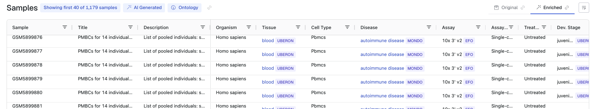
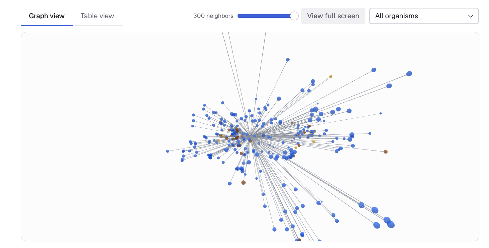
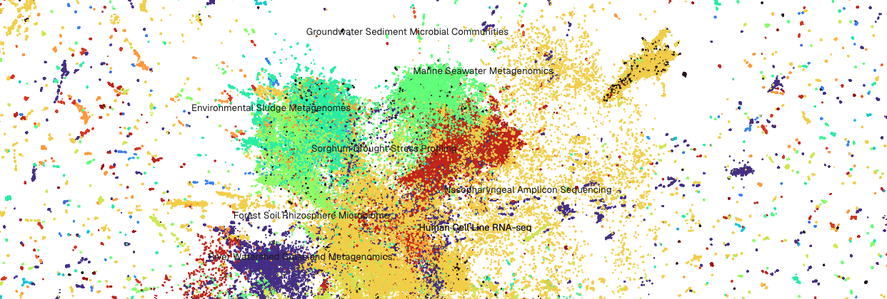

<div align="center">
  <picture>
    <source media="(prefers-color-scheme: dark)" srcset="./public/logo-dark.webp">
    <source media="(prefers-color-scheme: light)" srcset="./public/logo-light.webp">
    
  </picture>
</div>

<p align="center">
  
  
  
</p>
<p align="center">
  <a href="https://seqout.org/"></a>
  <a href="https://seqout.org/cli/R/"></a>
  <a href="https://seqout.org/cli/python/"></a>
  <a href="https://seqout.org/cli/"></a>
  <a href="https://seqout.org/mcp/"></a>
</p>

Seqout is a search engine for finding genomic datasets across NCBI, EMBL-EBI, CNCB-NGDC & DDBJ portals. To learn more about how search works, [read more](https://seqout.org/howsearchworks).

## Harmonised sample metadata

Seqout harmonises heterogenous sample metadata into fifteen standardised attributes across different datasets hosted in different databases. This is available under the "Enriched" tab.



## Semantically similar datasets

Apart from text-based search, Seqout also offers dataset discovery via semantic similarity using vector embeddings.



We also have an embedding similarity-based 2D map of datasets across seven repositories. Visit [seqout.org/map](https://seqout.org/map).



## Connect with AI agents

Seqout also has an MCP server to help work with genomic datasets using AI agents (such as Claude, Codex, Antigravity etc.). Visit [seqout.org/mcp](https://seqout.org/mcp) for more information.

[](https://claude.ai/directory/seqout)

## CLI, Python & R packages

The `seqout` package is available via PyPI. For docs, go here: https://seqout.org/cli/python/. This can be used as both CLI command and a Python package.

[](https://pypi.org/project/seqout/)

Documentation for the R package is available at: https://seqout.org/cli/R

## Issues & support

Found a bug or have a feature request? Please use [GitHub Issues](https://github.com/saketlab/seqout-web/issues).

## License

[BSD-3-Clause license](https://github.com/saketlab/seqout-web?tab=BSD-3-Clause-1-ov-file)

## Citation

If you have found Seqout helpful for your research, please cite us with the following:

```bib
@misc{seqout,
  author = {Mukherjee, Aniruddha and Reddy, Mukesh and Choudhary, Saket},
  title  = {Seqout: metadata harmonisation for genomics dataset discovery},
  year   = {2026},
  url    = {https://seqout.org},
}
```
